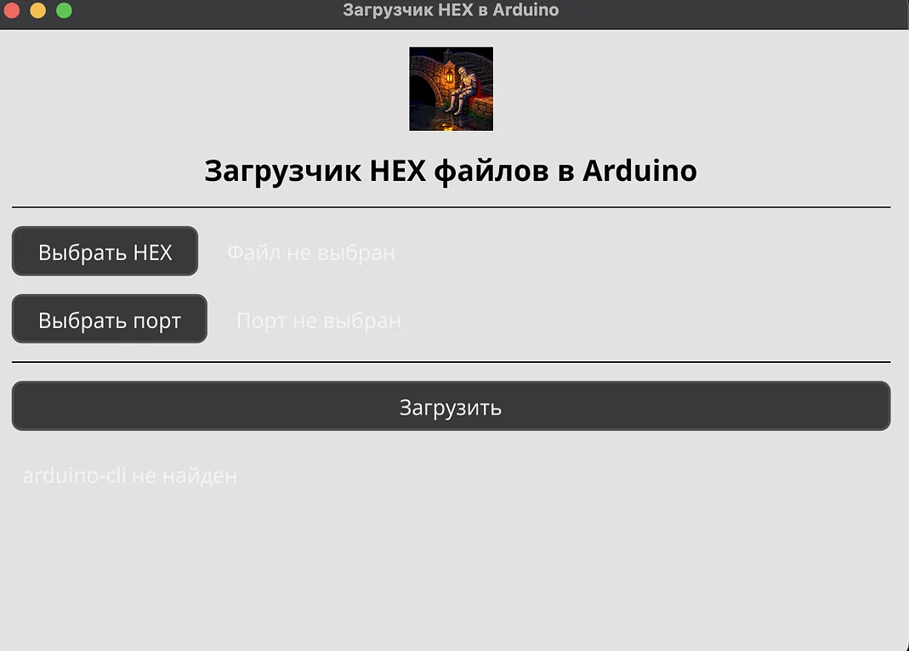

# 📟 Hex Loader

<p align="center">
  
</p>

<p align="center">
  <b>Кроссплатформенное десктопное приложение для прошивки Arduino-совместимых плат готовыми <code>.hex</code>-файлами</b>
</p>

<p align="center">
  
  
  
  
  
  
</p>

---

## 📖 О проекте

**Hex Loader** — настольное приложение на **Go + Fyne**, которое упрощает прошивку Arduino-совместимых плат заранее скомпилированными `.hex`-файлами. Оно избавляет от необходимости запоминать команды `arduino-cli` и позволяет прошивать платы буквально в три клика.

Приложение автоматически определяет подключённые платы, предлагает список популярных FQBN и следит за статусом загрузки.

Проект демонстрирует **полный CI/CD пайплайн** на GitHub Actions: автоматическую сборку под четыре платформы и публикацию бинарников в **GitHub Releases** по тегу `v*`.

---

## ✨ Возможности

| | Возможность |
|---|---|
| 📂 | Выбор `.hex`-файла через файловый диалог с фильтром по расширению |
| 🔌 | Автоопределение подключённых Arduino-плат через `arduino-cli board list` |
| 🎯 | Выбор FQBN из готового списка (Uno, Nano, Mega, Leonardo, ESP32, ESP8266) или ручной ввод |
| ⬆️ | Прошивка через `arduino-cli upload` с индикацией статуса |
| 💾 | Сохранение последнего выбранного файла в preferences приложения |
| 🎨 | Кастомная светлая тема Fyne: увеличенные отступы, кнопки с обводкой, своя иконка |
| ⚠️ | Проверка прав на последовательные порты (только для Linux) |
| 🚀 | Автосборка и публикация релизов под 4 платформы через GitHub Actions |

---

## 🖼 Скриншот

<p align="center">
  
  <br>
  <em>Главное окно приложения. Показано состояние, когда <code>arduino-cli</code> не установлен — кнопки неактивны, а в статусной строке выводится подсказка.</em>
</p>

---

## 🧰 Технологический стек

| Компонент | Роль |
|---|---|
| **Go 1.23** | Язык разработки |
| **Fyne v2.8.0** | Кроссплатформенный GUI-тулкит |
| **arduino-cli** | Внешний CLI для прошивки плат |
| **GitHub Actions** | CI/CD пайплайн |
| **softprops/action-gh-release** | Публикация релизов |

---

## 📦 Установка готовых бинарников

Скачайте нужный архив со [страницы релизов](https://github.com/ChrisRedfield48/hex-loader/releases):

| Платформа | Файл |
|---|---|
| 🐧 Linux (x86_64) | `HexLoader-linux-amd64.tar.gz` |
| 🍎 macOS (Intel) | `HexLoader-macos-amd64.tar.gz` |
| 🍎 macOS (Apple Silicon) | `HexLoader-macos-arm64.tar.gz` |
| 🪟 Windows (x86_64) | `HexLoader-windows-amd64.zip` |

**Linux / macOS:**
```bash
tar -xzf HexLoader-<platform>.tar.gz
chmod +x HexLoader
./HexLoader
```

**Windows:**
```
Распакуйте .zip и запустите HexLoader.exe
```

> 💡 Для macOS может потребоваться снять карантин: `xattr -dr com.apple.quarantine HexLoader`

---

## 🔧 Зависимости

Перед запуском убедитесь, что установлен [`arduino-cli`](https://arduino.github.io/arduino-cli/latest/installation/):

**macOS:**
```bash
brew install arduino-cli
```

**Linux:**
```bash
curl -fsSL https://raw.githubusercontent.com/arduino/arduino-cli/master/install.sh | sh
sudo mv bin/arduino-cli /usr/local/bin/
```

**Windows:** скачайте `.zip` со страницы [arduino-cli releases](https://github.com/arduino/arduino-cli/releases) и добавьте `arduino-cli.exe` в `PATH`.

Проверка:
```bash
arduino-cli version
```

> ⚠️ **Только для Linux.** Чтобы приложение могло работать с последовательными портами, добавьте пользователя в группу `dialout`:
> ```bash
> sudo usermod -a -G dialout $USER
> ```
> После этого **обязательно перелогиньтесь**. На macOS и Windows это не требуется.

---

## 🚀 Локальная сборка из исходников

### Предварительные требования

- **Go 1.22+** ([скачать](https://go.dev/dl/))
- **C-компилятор** и системные библиотеки для Fyne

### Linux

```bash
sudo apt-get update
sudo apt-get install -y libgl1-mesa-dev xorg-dev libxkbcommon-dev

git clone https://github.com/ChrisRedfield48/hex-loader.git
cd hex-loader
go mod tidy
go run .
```

### macOS

```bash
xcode-select --install

git clone https://github.com/ChrisRedfield48/hex-loader.git
cd hex-loader
go mod tidy
go run .
```

### Windows (кросс-компиляция из Linux)

```bash
sudo apt-get install -y gcc-mingw-w64-x86-64
CGO_ENABLED=1 GOOS=windows GOARCH=amd64 \
  CC=x86_64-w64-mingw32-gcc \
  go build -trimpath -ldflags "-s -w" -o HexLoader.exe .
```

---

## 🏗 CI/CD пайплайн

Проект использует **GitHub Actions** для автоматической сборки и релизов.

### Как это работает

```
push в main ────► build (4 платформы) ────► artifacts
                                              │
git tag v0.1.0 ─► build ──────────────────────┤
                                              ▼
                                          release
                                     (GitHub Release)
```

### Джобы

| Джоба | Триггер | Результат |
|---|---|---|
| `build` | push, PR, тег, ручной запуск | 4 артефакта: Linux, Windows, macOS Intel, macOS ARM |
| `release` | push тега `v*` | GitHub Release с вложениями |

### Матрица сборки

| OS | Arch | Runner | Файл |
|---|---|---|---|
| Linux | amd64 | `ubuntu-latest` | `HexLoader-linux-amd64.tar.gz` |
| Windows | amd64 | `ubuntu-latest` (mingw) | `HexLoader-windows-amd64.zip` |
| macOS | amd64 | `macos-13` | `HexLoader-macos-amd64.tar.gz` |
| macOS | arm64 | `macos-14` | `HexLoader-macos-arm64.tar.gz` |

### Как выпустить новую версию

```bash
git tag v0.1.0
git push origin v0.1.0
```

Через ~5 минут в разделе **Releases** появится готовый релиз с четырьмя архивами и автоматически сгенерированными release notes.

---

## 📁 Структура проекта

```
hex-loader/
├── .github/
│   └── workflows/
│       └── build-release.yml    # CI/CD пайплайн
├── docs/
│   └── screenshot-main.png      # скриншот главного окна
├── main.go                      # исходный код приложения
├── go.mod                       # модуль Go
├── go.sum                       # хеши зависимостей
├── icon.png                     # иконка приложения
├── FyneApp.toml                 # метаданные для fyne package
├── LICENSE                      # MIT
└── README.md
```

---

## 🎯 Использование

1. **Запустите приложение** — при старте оно проверит наличие `arduino-cli`.
2. **Нажмите «Выбрать HEX»** — выберите готовый `.hex`-файл. Путь сохранится и подставится при следующем запуске.
3. **Подключите Arduino** и нажмите **«Выбрать порт»** — приложение покажет список найденных плат.
4. Если FQBN не определился автоматически — выберите его из списка популярных плат или введите вручную.
5. **Нажмите «Загрузить»** — статус внизу покажет прогресс и результат.

---

## 🩹 Решение проблем

<details>
<summary><b>«arduino-cli не найден» на скриншоте</b></summary>

Установите `arduino-cli` и убедитесь, что он доступен в `PATH`:
```bash
which arduino-cli    # macOS / Linux
where arduino-cli    # Windows
```
После установки перезапустите приложение.
</details>

<details>
<summary><b>«Ядро arduino:avr не установлено»</b></summary>

Установите нужное ядро:
```bash
arduino-cli core update-index
arduino-cli core install arduino:avr
```
Для ESP32:
```bash
arduino-cli config init
arduino-cli config add board_manager.additional_urls \
  https://espressif.github.io/arduino-esp32/package_esp32_index.json
arduino-cli core update-index
arduino-cli core install esp32:esp32
```
</details>

<details>
<summary><b>Порты не определяются на Linux</b></summary>

Добавьте пользователя в группу `dialout` и перелогиньтесь:
```bash
sudo usermod -a -G dialout $USER
```
Проверка: `groups | grep dialout`
</details>

<details>
<summary><b>Ошибка «unknown escape» при компиляции</b></summary>

Возникает, если в строковых литералах есть эмодзи. Используйте Unicode-escape (`"\u26A0"`) вместо прямых эмодзи или уберите их из строк.
</details>

<details>
<summary><b>macOS: «HexLoader cannot be opened because the developer cannot be verified»</b></summary>

Снимите карантин:
```bash
xattr -dr com.apple.quarantine HexLoader
```
</details>

<details>
<summary><b>Linux: «X11/Xlib.h: No such file or directory»</b></summary>

Установите зависимости Fyne:
```bash
sudo apt-get install -y libgl1-mesa-dev xorg-dev libxkbcommon-dev
```
</details>

---

## 🤝 Вклад

Pull request'ы приветствуются! Для крупных изменений сначала откройте issue, чтобы обсудить, что вы хотите изменить.

1. Форкните репозиторий
2. Создайте ветку (`git checkout -b feature/amazing-feature`)
3. Закоммитьте изменения (`git commit -m 'Add amazing feature'`)
4. Запушьте (`git push origin feature/amazing-feature`)
5. Откройте Pull Request

---

## 📄 Лицензия

Распространяется под лицензией **MIT**. См. файл [LICENSE](LICENSE) для подробностей.

---

<p align="center">
  Сделано с ❤️ на <b>Go</b> и <b>Fyne</b>
  <br>
  <a href="https://github.com/ChrisRedfield48/hex-loader/issues">🐛 Сообщить о баге</a> ·
  <a href="https://github.com/ChrisRedfield48/hex-loader/issues">💡 Предложить идею</a> ·
  <a href="https://github.com/ChrisRedfield48/hex-loader/releases">📦 Скачать</a>
</p>
